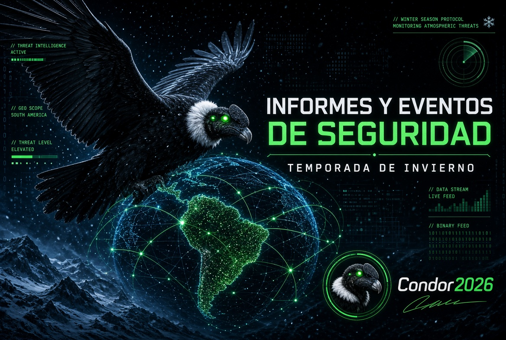

# Informes y Eventos de Seguridad — Temporada de Invierno

[](https://github.com/Condor2026/Informes_y_eventos_Seguridad_Tempotada_Invierno/blob/main/LICENSE)
[](https://github.com/Condor2026/Informes_y_eventos_Seguridad_Tempotada_Invierno/commits/main)
[](https://github.com/Condor2026/Informes_y_eventos_Seguridad_Tempotada_Invierno)
[](https://github.com/Condor2026/Informes_y_eventos_Seguridad_Tempotada_Invierno/issues)
[](https://github.com/Condor2026/Informes_y_eventos_Seguridad_Tempotada_Invierno/stargazers)
[](https://github.com/Condor2026/Informes_y_eventos_Seguridad_Tempotada_Invierno)
[](https://github.com/Condor2026/Informes_y_eventos_Seguridad_Tempotada_Invierno)
[](https://github.com/Condor2026/Informes_y_eventos_Seguridad_Tempotada_Invierno/blob/main/SECURITY.md)
[](https://github.com/Condor2026/Informes_y_eventos_Seguridad_Tempotada_Invierno/blob/main/SECURITY.md)
[](https://github.com/Condor2026/Informes_y_eventos_Seguridad_Tempotada_Invierno/blob/main/CONTRIBUTING.md)
[](https://github.com/Condor2026/Informes_y_eventos_Seguridad_Tempotada_Invierno)
[](https://github.com/Condor2026/Informes_y_eventos_Seguridad_Tempotada_Invierno)
[](https://github.com/Condor2026/Informes_y_eventos_Seguridad_Tempotada_Invierno)



Repositorio de **informes de inteligencia de amenazas (CTI)** y **registros de eventos de seguridad globales**, elaborados a partir de fuentes públicas identificables (OSINT) y publicados en formato de titulares de evento, sin desarrollo analítico extendido. Cada informe es un archivo Markdown autocontenido, versionado y fechado.

--- 
**Repositorio:** https://github.com/Condor2026/Informes_y_eventos_Seguridad_Tempotada_Invierno
**Autor:** Condor2026
**Licencia:** CC BY 4.0
---

## ¿Qué es este repositorio?

Este repositorio es un **archivo vivo de eventos de seguridad**. No es un blog, no es un producto comercial de inteligencia y no es un feed de noticias. Es un **registro estructurado y trazable** de lo que ocurre en el panorama global de seguridad —terrorismo, ciberataques, disturbios, conflictos, desastres, crimen organizado, leaks y hacktivismo— tal como se observa en fuentes públicas.

La idea es simple: **preservar el evento, no la interpretación**. Cada titular se registra con su fuente, su fecha y su contexto mínimo. El análisis posterior puede hacerse encima, pero el registro queda limpio, fechado y atribuido.

El proyecto nace de una necesidad práctica: la información de seguridad se dispersa, se pierde, se desactualiza y se mezcla con ruido. Aquí se recoge, se ordena y se deja disponible para consulta, comparación y auditoría.

---

## ¿Qué estamos haciendo?

Estamos construyendo un **archivo cronológico de eventos de seguridad global**, con cuatro objetivos concretos:

1. **Preservar** un registro de eventos tal como fueron observados en el periodo de corte, sin reescrituras posteriores que alteren el original.
2. **Servir como fuente primaria de referencia** para análisis, auditorías, investigaciones o docencia, sin pretender ser un producto de inteligencia acabado ni una evaluación de severidad propia.
3. **Estandarizar** el formato de los informes para que sean comparables entre periodos, fuentes y regiones.
4. **Documentar la metodología** (fuentes, criterios de inclusión, tratamiento de duplicados y ruido) para que cualquiera pueda reproducir o cuestionar el proceso.

No estamos haciendo:
- Un producto de inteligencia comercial.
- Un feed de noticias en tiempo real.
- Un repositorio de exploits, IOCs accionables o herramientas ofensivas.
- Un archivo de datos personales de víctimas.
- Un altavoz de propaganda ni de desinformación.

---

## ¿Qué vas a encontrar aquí?

- **Informes de eventos globales**: registros cronológicos de seguridad, con fuentes y fechas.
- **Informes de monitorización DDoS**: análisis de grupos, países y ASN, con advertencias explícitas sobre el uso de IPs de baja fidelidad.
- **Informes OSINT temáticos**: seguimiento de narrativas, actores y campañas en canales públicos.
- **Documentación del proyecto**: código de conducta, política de seguridad, accesibilidad y guía de contribución.
- **Plantillas de issue y pull request**: para que cualquier persona pueda reportar errores, mejoras o barreras de accesibilidad de forma estructurada.

---

## ¿Qué NO vas a encontrar aquí?

Para evitar malentendidos, este repositorio **no contiene**:

- Exploits funcionales ni pruebas de concepto ofensivas.
- IOCs accionables (hashes, IPs, dominios) listos para bloqueo automatizado.
- Herramientas ofensivas ni enlaces a su descarga.
- Datos personales de víctimas, actores o terceros.
- Credenciales, contraseñas, tokens ni claves API.
- Enlaces a foros criminales, mercados de datos robados o grupos cerrados.
- Propaganda o desinformación reproducida sin contexto analítico.
- Evaluaciones de severidad propias presentadas como veredictos.

Lo que sí contiene son **titulares de evento, con fuente, fecha y contexto**, y un análisis defensivo de TTPs y narrativas.

---

## Principios éticos

El repositorio se rige por un **código de conducta** y una **política de seguridad** explícitos. Los principios son:

1. **Ética primero:** el contenido sirve a fines defensivos, de concienciación o de investigación legítima.
2. **Transparencia:** toda afirmación se atribuye a su fuente original.
3. **Respeto:** las discrepancias se resuelven con argumentos, no con ataques personales.
4. **No amplificación:** no se reproduce propaganda, desinformación ni contenido de grupos hostiles más allá de lo necesario para su análisis.
5. **Privacidad:** no se publican datos personales de víctimas, actores ni terceros.
6. **No facilitación:** no se enlazan foros criminales, mercados de datos robados, herramientas ofensivas ni exploits.
7. **Profesionalidad:** el tono es técnico, sobrio y verificable.

Estos principios están desarrollados en [`CODE_OF_CONDUCT.md`](CODE_OF_CONDUCT.md) y [`SECURITY.md`](SECURITY.md).

---

## ¿Cómo se elaboran los informes?

El proceso es **manual y verificable**, no automático:

1. **Recolección:** se parte de volcados de monitorización OSINT (canales de Telegram, medios internacionales, feeds de ransomware y DDoS, IODA, ADS-B, entre otros).
2. **Filtrado:** se descartan canales que solo devuelven error o no aportan contenido, y se descarta ruido (resultados deportivos, tipos de cambio, eventos sin relevancia de seguridad).
3. **Extracción:** se identifican eventos, se registran con su fuente, fecha y enlace cuando es público y no criminal.
4. **Estructuración:** se organizan en las secciones temáticas del informe.
5. **Corroboración:** se marca qué está confirmado, qué es declaración de parte interesada y qué no se ha podido verificar.
6. **Análisis:** se identifican narrativas, TTPs y correlaciones, siempre con la limitación explícita.
7. **Publicación:** se versiona el informe en Markdown y se actualiza el índice del repositorio.

El proceso no pretende ser perfecto. Pretende ser **transparente**: cualquiera puede ver qué se incluyó, qué se descartó y por qué.

---

## Fuentes utilizadas

Todas las fuentes son **públicas e identificables**:

- **Medios internacionales:** Reuters, AP, BBC, France 24, DW, Le Monde, El País, Clarín, Infobae, SCMP, The Hindu, Japan Times, Al Jazeera, ANSA, Euronews, RFI, NYT, ABC Australia, Der Spiegel, Tagesschau, La Repubblica, La Vanguardia, El Mundo, ElDiario.es, 20minutos, El Correo, Deia.
- **Feeds de ransomware:** `Ransomware.live`.
- **Feeds de DDoS:** `NoName057(16)`, `Killnet`.
- **Feeds de hosts comprometidos:** `Blocklist.de`, `ET Compromised`, GreenSnow, CI Army, DShield.
- **Conectividad:** IODA.
- **Vuelos militares:** ADS-B.
- **Canales públicos de Telegram:** monitorizados como OSINT, sin infiltración ni acceso a grupos cerrados.

**No se utilizan** fuentes privadas, filtraciones no públicas, datos personales de víctimas, credenciales, exploits ni enlaces a foros criminales.

---

## Estructura del repositorio

```text
.
├── .github/
│   ├── ISSUE_TEMPLATE/
│   │   ├── bug_report.md
│   │   ├── informe_erroneo.md
│   │   ├── accessibility_issue.md
│   │   ├── feature_request.md
│   │   └── config.yml
│   └── pull_request_template.md
├── .gitattributes
├── .gitignore
├── ACCESSIBILITY.md
├── CODE_OF_CONDUCT.md
├── CONTRIBUTING.md
├── Eventos_Globales_Andromeda.md
├── Informe_AndromedaUniverso25_Oct_Nov.md
├── Informe_Andromeda_1.md
├── Informe_Nexsus_Osint_X_12_Noviembre.md
├── Informe_Octubre_Noviembre.md
├── LICENSE
├── README.md
├── SECURITY.md
└── requirements.txt
```

---

## Índice de informes

| Informe | Periodo / Alcance | Archivo | Estado |
|---|---|---|---|
| **Eventos Globales Andromeda** | Eventos globales de seguridad (registro) | [`Eventos_Globales_Andromeda.md`](Eventos_Globales_Andromeda.md) | Activo |
| **Andromeda Universo 25 (Oct–Nov)** | Monitor DDoS y eventos de seguridad, oct–nov | [`Informe_AndromedaUniverso25_Oct_Nov.md`](Informe_AndromedaUniverso25_Oct_Nov.md) | Activo |
| **Informe Andromeda 1** | Informe Andromeda — parte 1 | [`Informe_Andromeda_1.md`](Informe_Andromeda_1.md) | Activo |
| **Nexsus OSINT X — 12 Nov** | OSINT X — 12 de noviembre | [`Informe_Nexsus_Osint_X_12_Noviembre.md`](Informe_Nexsus_Osint_X_12_Noviembre.md) | Activo |
| **Octubre–Noviembre** | Eventos de seguridad oct–nov | [`Informe_Octubre_Noviembre.md`](Informe_Octubre_Noviembre.md) | Activo |

*El índice se actualiza con cada nuevo informe publicado.*

---

## Documentación del proyecto

| Documento | Propósito |
|---|---|
| [`README.md`](README.md) | Presentación, contexto, índice y guía general |
| [`LICENSE`](LICENSE) | Licencia CC BY 4.0 |
| [`CONTRIBUTING.md`](CONTRIBUTING.md) | Cómo contribuir al repositorio |
| [`CODE_OF_CONDUCT.md`](CODE_OF_CONDUCT.md) | Normas de convivencia |
| [`SECURITY.md`](SECURITY.md) | Política de seguridad y reporte de incidentes |
| [`ACCESSIBILITY.md`](ACCESSIBILITY.md) | Declaración de accesibilidad |
| [`requirements.txt`](requirements.txt) | Dependencias opcionales (validación/exportación) |

---

## Formato de los informes

Cada informe sigue una estructura fija y predecible:

- **Encabezado:** periodo, alcance, fuente, fecha de corte, estado de verificación.
- **Resumen ejecutivo (BLUF):** los ejes temáticos y los eventos de mayor relevancia.
- **Secciones temáticas:**
  - Terrorismo y violencia política.
  - Ciberataques: brechas, ransomware, vulnerabilidades, infraestructura crítica, IA y cadena de suministro.
  - Disturbios, protestas y revueltas sociales.
  - Conflictos geopolíticos.
  - Desastres naturales.
  - Crimen urbano y crimen organizado.
  - Leaks y hacktivismo.
  - Otros eventos relevantes.
- **Línea temporal:** cronología de los eventos registrados.
- **Eventos subrayados:** los de mayor relevancia, con evidencia textual y enlace a la fuente.
- **Matriz de corroboración:** qué está confirmado, qué no, y con qué nivel de confianza.
- **Narrativas identificadas:** temas, encuadres y técnicas de desinformación observadas.
- **Indicadores de actividad (IOCs narrativos):** canales, hashtags y términos de búsqueda para monitorización, sin datos personales ni enlaces a foros criminales.
- **Mapeo MITRE ATT&CK** (adaptado a influencia cuando aplica).
- **Evaluación de riesgo** desde una perspectiva defensiva.
- **Gaps:** qué falta, qué no se ha podido verificar y por qué.
- **Recomendaciones** para SOC, equipos de concienciación y liderazgo.
- **Fuentes y trazabilidad.**
- **Declaración de integridad.**

---

## Cómo usar este repositorio

```bash
git clone https://github.com/Condor2026/Informes_y_eventos_Seguridad_Tempotada_Invierno
cd Informes_y_eventos_Seguridad_Tempotada_Invierno
```

Los informes son **Markdown plano**, legibles sin dependencias. Se pueden abrir con cualquier editor de texto, visor de Markdown o herramienta de conversión (Pandoc, etc.).

Las dependencias de `requirements.txt` son **opcionales** y solo se usan para validación y exportación:

- `markdownlint-cli` — validación de formato Markdown.
- `markdown-link-check` — verificación de enlaces.
- `pymarkdownlnt` — validación adicional.

---

## Contribuir

Las contribuciones son bienvenidas y se centran en **correcciones de formato, erratas, atribuciones y accesibilidad**. No se aceptan informes nuevos sin revisión previa de metodología.

Antes de abrir un issue o pull request, revisa:

- [`CONTRIBUTING.md`](CONTRIBUTING.md) — cómo contribuir.
- [`CODE_OF_CONDUCT.md`](CODE_OF_CONDUCT.md) — normas de convivencia.
- [`SECURITY.md`](SECURITY.md) — cómo reportar problemas de seguridad.
- [`ACCESSIBILITY.md`](ACCESSIBILITY.md) — cómo reportar barreras de accesibilidad.

Las plantillas de issue y pull request están en [`.github/`](.github/) y se cargan automáticamente al abrir uno nuevo.

---

## Seguridad

Para reportar problemas de seguridad, datos personales mal anonimizados, errores graves de atribución o contenido que viole las políticas del repositorio, consulta [`SECURITY.md`](SECURITY.md). Los reportes se tratan con confidencialidad y diligencia.

---

## Accesibilidad

El repositorio se compromete a que sus contenidos sean legibles por tecnologías de asistencia. Consulta [`ACCESSIBILITY.md`](ACCESSIBILITY.md) para conocer las medidas aplicadas, las limitaciones conocidas y cómo reportar barreras.

---

## Limitaciones y transparencia

Este repositorio **no es perfecto** y no pretende serlo. Sus limitaciones son explícitas:

- **No hay verificación independiente** de la mayoría de los eventos. La confianza se marca en cada informe.
- **Los volcados de origen pueden estar truncados** o presentar codificación corrupta (mojibake).
- **No se enlazan fuentes citadas que sean foros criminales** por razones éticas, lo que limita la verificación directa.
- **La severidad indicada es la del feed de origen**, no una evaluación propia.
- **El análisis de TTPs y narrativas es descriptivo**, no operativo.
- **Las listas de IPs de DDoS son de baja fidelidad** y no deben usarse para bloqueo automatizado.
- **El repositorio no constituye asesoramiento** legal, financiero ni de seguridad operacional.

Estas limitaciones no son un defecto: son parte del contrato de transparencia del repositorio.

---

## Licencia

Contenido bajo **Creative Commons Attribution 4.0 International (CC BY 4.0)**. Ver [`LICENSE`](LICENSE).

El código de utilidades, si lo hubiera, se distribuye bajo MIT.

---

## Descargo de responsabilidad

Los informes se basan en fuentes públicas identificables (medios internacionales, feeds OSINT, canales de Telegram, `Ransomware.live`, `NoName057(16)`, `Killnet`, `Blocklist.de`, `ET Compromised`, IODA, ADS-B). No hay infiltración ni acceso a grupos cerrados. La exactitud, verificación y vigencia de cada titular corresponde a la fuente original.

Este repositorio **no constituye asesoramiento legal, financiero ni de seguridad operacional**. El mantenedor no se hace responsable del uso indebido del material.

---

## Contacto

- **GitHub:** [@Condor2026](https://github.com/Condor2026)
- **Repositorio:** https://github.com/Condor2026/Informes_y_eventos_Seguridad_Tempotada_Invierno
